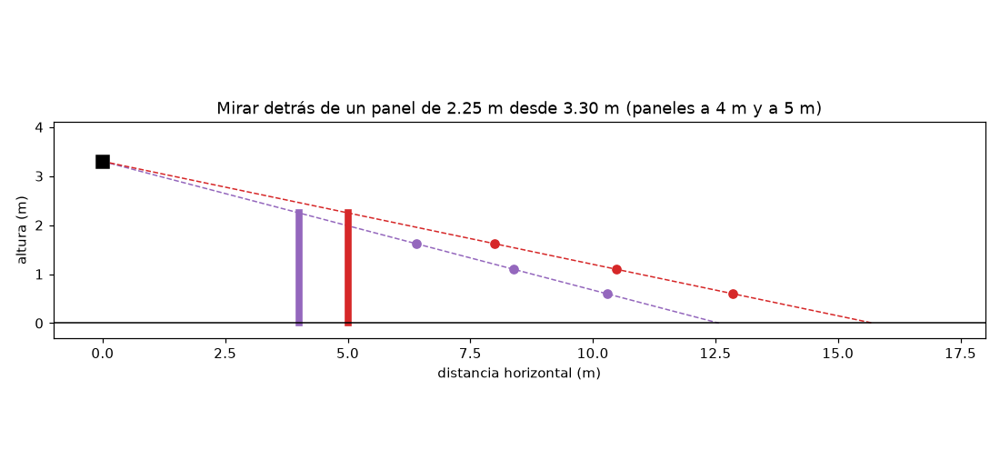
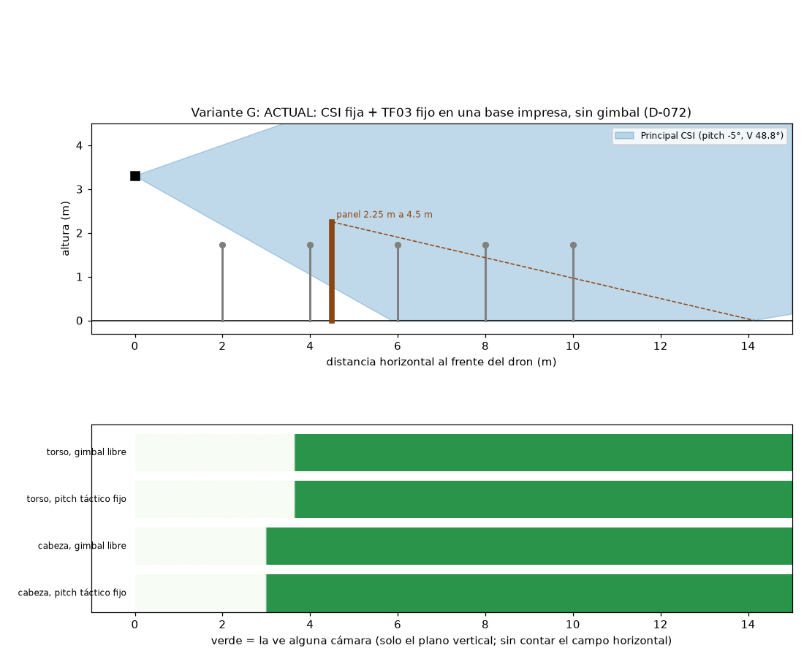
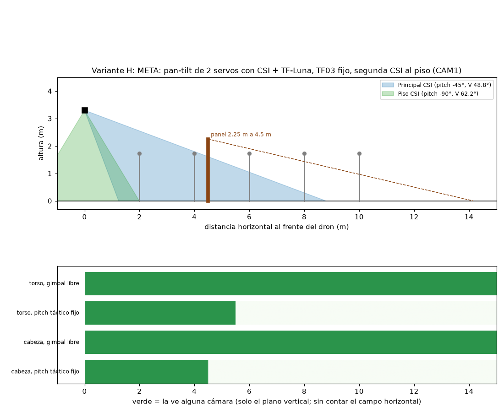
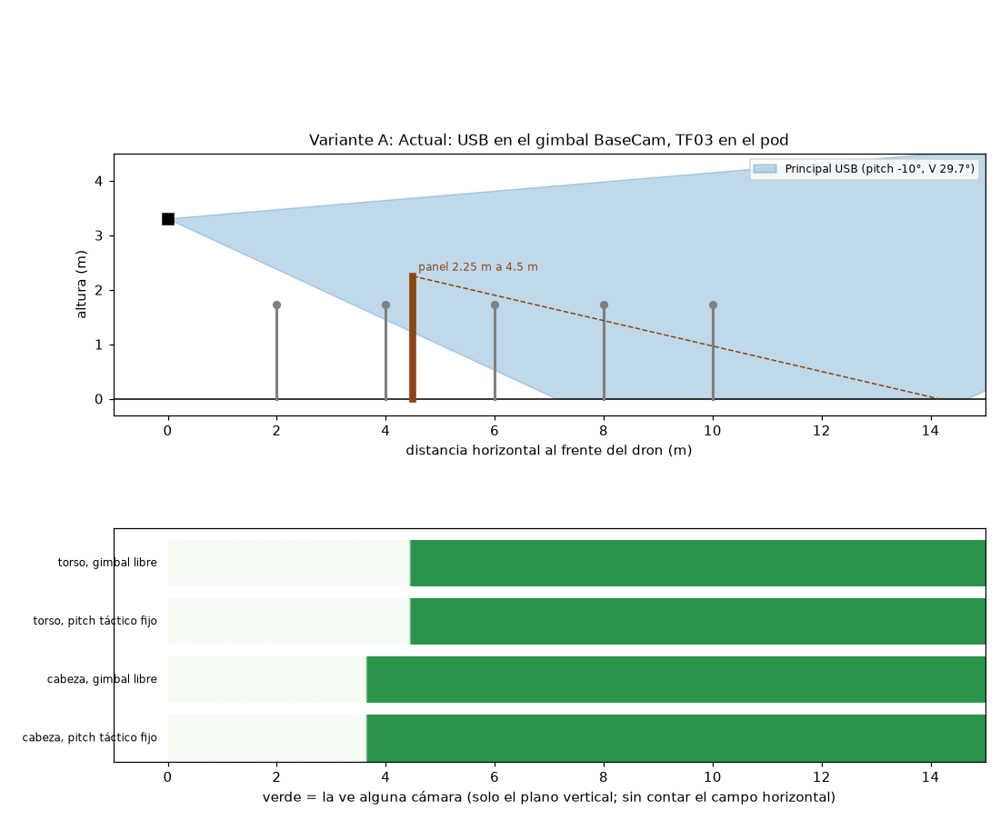
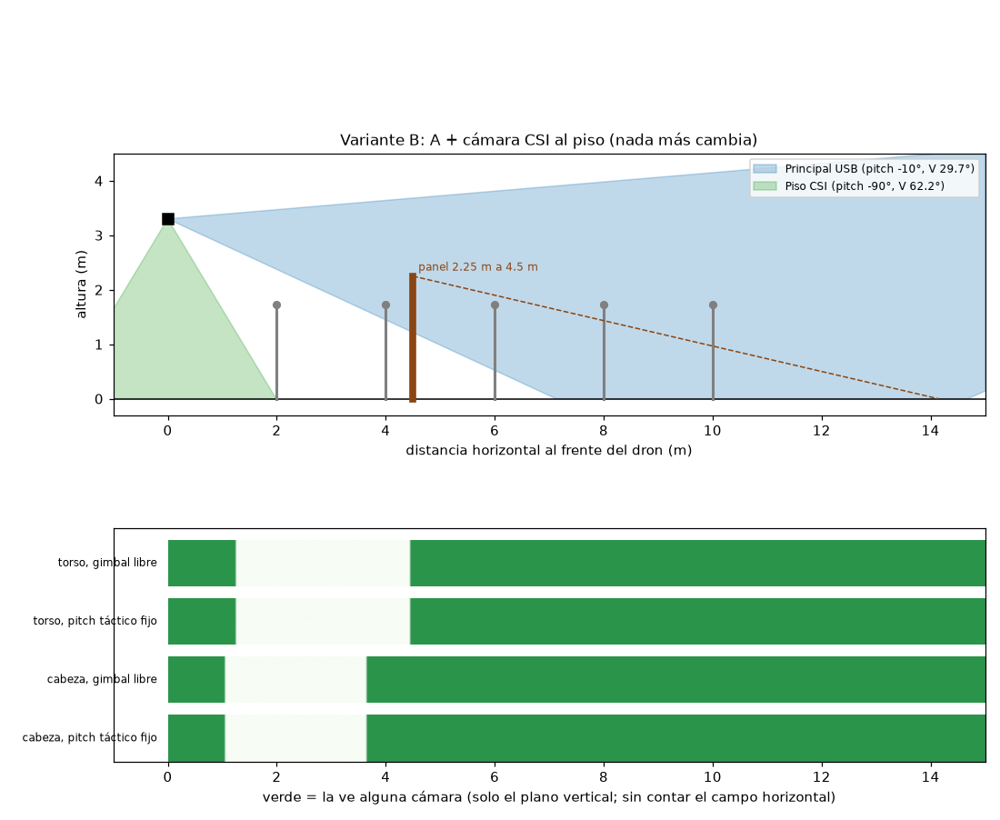
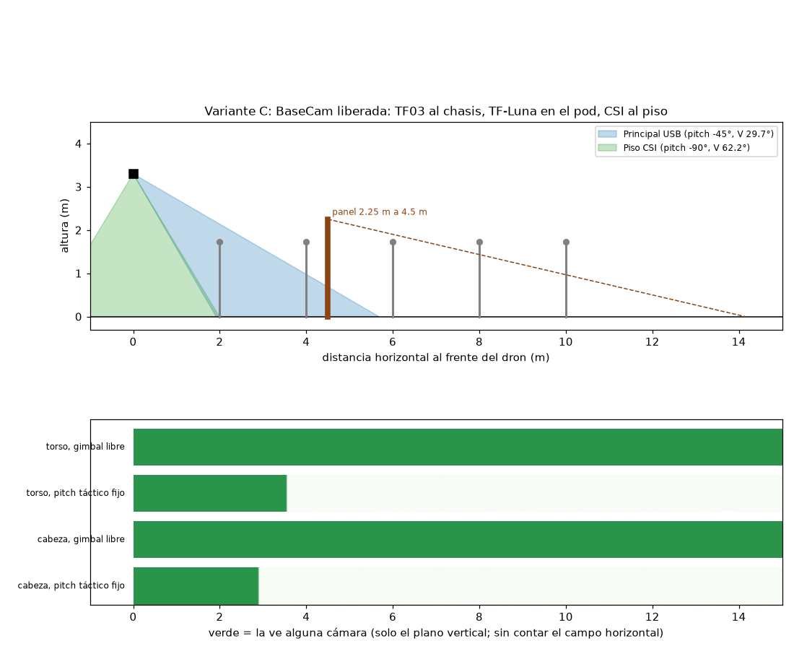
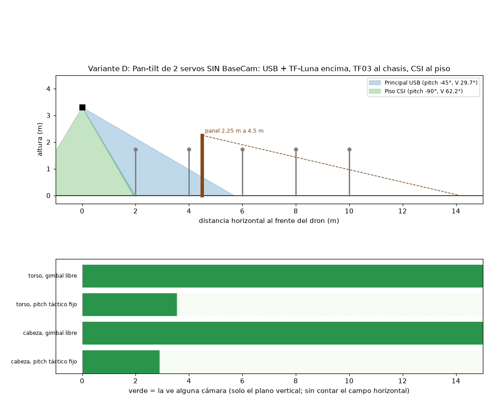
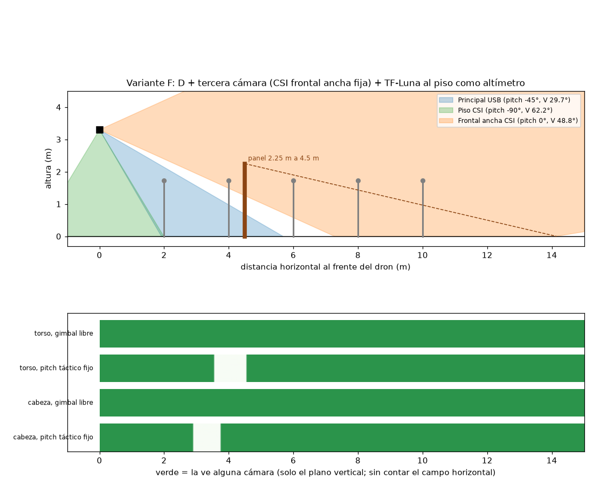

# Cobertura de las cámaras por variante

Análisis **geométrico** (sin simulación): qué ve cada variante a 3.30 m de altura, dónde queda ciega y qué pasa al mirar detrás de un panel de
2.25 m. Se regenera con `03_SIMULACION_RL\.venv\Scripts\python.exe analisis_cobertura.py` (lee los `config_sim/variante_*.json`). El campo
del IMX219 (62.2° × 48.8°) es **nominal, sin medir**; las alturas de cabeza (1.62 m) y torso (1.25 m) de una persona de 1.72 m son **estimadas**.

## Lo que dice, en sencillo (actualizado 2026-10-20, D-072)

**Hoy el dron es la variante G** (CSI fija a −5° + TF03 fijo, sin gimbal ni USB) **y la meta es la H** (pan-tilt con CSI + TF-Luna, TF03 fijo, segunda CSI al
piso). Las variantes A–F **quedaron descartadas** (usaban el gimbal o la USB) y se dejan solo como referencia.

1. **G (hoy): anillo ciego.** Con la CSI fija a −5° (62.2° × 48.8° nominal), la cabeza de una persona de 1.72 m se ve **desde ~3.0 m** hacia afuera y el
   suelo **desde ~5.9 m**: una persona que se acerca a menos de 3 m sale del cuadro, y nada ve lo que hay debajo del dron.
2. **H (meta): sin anillo ciego.** La CSI en el pan-tilt baja hasta −45°: con el tilt libre ve la cabeza desde ~0.6 m hasta más de 15 m, y la segunda CSI al piso
   (−90°) cubre lo de justo debajo. Con el tilt fijo en −45° solo ve de 0 a 4.5 m: hay que ir cambiando el cabeceo según la distancia (para eso es el pan-tilt).
3. **Lo que sale del campo más ancho de la CSI** (62.2° × 48.8° contra 38.9° × 29.7° de la USB): se ve más de lado y más de arriba abajo, pero con menos
   píxeles por grado (el YOLO ve más chica a la persona lejana).
4. **Detrás del panel (2.25 m) desde 3.30 m:** de pie queda oculta de 2.4 a 3.0 m detrás, agachada de 4.4 a 5.5 m, gateando de 6.3 a 7.9 m (paneles a 4–5 m): lo
   decide la maniobra del dron, no las cámaras.

Las figuras `cobertura/cobertura_variante_G.png` y `_H.png` son las que importan; `_A` a `_F` son de las variantes descartadas.

Supuestos: dron a **3.3 m**; persona de pie de **1.72 m** (cabeza = centro a 1.62 m y torso = centro a 1.25 m: **estimados**); cámaras en el centro del dron; pitch táctico −45° donde el gimbal lo permite (A y B: −10°, el tope real de hoy); solo plano vertical (se ignora que el objetivo esté fuera del campo horizontal). Campos: USB HFOV 38.9° × VFOV 29.7° (medido); IMX219 62.2° × 48.8° (**nominal, sin medir**), con su lado largo a lo largo del vuelo.

### Tabla de cobertura vertical (distancias horizontales a las que alguna cámara ve el punto)

«Pitch fijo» = la cámara principal quieta en su pitch táctico. «Gimbal libre» = la cámara principal puede tomar cualquier pitch entre su tope bajo y +15° (lo que hace el seguimiento). La diferencia más importante entre variantes es **la distancia mínima**: con el tope bajo, A/B no ven la cabeza a menos de ~3.6 m y C-F sí desde ~1 m.

| Var. | Cámaras | Cabeza: pitch fijo | Cabeza: gimbal libre | Torso: gimbal libre | Suelo: ciego hasta |
|---|---|---|---|---|---|
| **A** | Principal USB (-10°) | 3.6–más de 15 m | 3.6–más de 15 m | 4.4–más de 15 m | 7.1 m |
| **B** | Principal USB (-10°) + Piso CSI (-90°) | 0.0–1.0 m; 3.6–más de 15 m | 0.0–1.0 m; 3.6–más de 15 m | 0.0–1.2 m; 4.4–más de 15 m | 0.0 m |
| **C** | Principal USB (-45°) + Piso CSI (-90°) | 0.0–2.9 m | 0.0–más de 15 m | 0.0–más de 15 m | 0.0 m |
| **D** | Principal USB (-45°) + Piso CSI (-90°) | 0.0–2.9 m | 0.0–más de 15 m | 0.0–más de 15 m | 0.0 m |
| **E** | Principal USB (-45°) + Piso CSI (-90°) | 0.0–2.9 m | 0.0–más de 15 m | 0.0–más de 15 m | 0.0 m |
| **F** | Principal USB (-45°) + Piso CSI (-90°) + Frontal ancha CSI (0°) | 0.0–2.9 m; 3.7–más de 15 m | 0.0–más de 15 m | 0.0–más de 15 m | 0.0 m |
| **G** | Principal CSI (-5°) | 3.0–más de 15 m | 3.0–más de 15 m | 3.6–más de 15 m | 5.9 m |
| **H** | Principal CSI (-45°) + Piso CSI (-90°) | 0.0–4.5 m | 0.0–más de 15 m | 0.0–más de 15 m | 0.0 m |

### Cámara al piso: huella a 3.30 m

- A la altura del suelo: ±1.99 m a lo largo del vuelo y ±1.50 m de lado (huella 3.98 × 2.99 m).
- A la altura del cabeza: ±1.01 m a lo largo del vuelo y ±0.76 m de lado (huella 2.03 × 1.52 m).
- A la altura del torso: ±1.24 m a lo largo del vuelo y ±0.93 m de lado (huella 2.47 × 1.86 m).

### Ancho lateral que ve la cámara principal (campo horizontal 38.9°)

- Pitch -45°, mirando al cabeza en el eje: distancia en línea recta 2.38 m → ancho 1.68 m.
- Pitch -45°, mirando al torso en el eje: distancia en línea recta 2.90 m → ancho 2.05 m.
- Pitch -10°, mirando al cabeza en el eje: distancia en línea recta 9.67 m → ancho 6.83 m.
- Pitch -10°, mirando al torso en el eje: distancia en línea recta 11.81 m → ancho 8.34 m.

### Mirar detrás de un panel de 2.25 m desde 3.30 m

Línea de vista desde la cámara que roza el borde de arriba del panel: hasta qué distancia DETRÁS del panel queda oculto cada punto.

| Postura (altura del punto) | Panel a 4 m | Panel a 5 m |
|---|---|---|
| De pie, cabeza (1.62 m) | 2.4 m | 3.0 m |
| De pie, torso (1.25 m) | 3.8 m | 4.8 m |
| Agachado (1.1 m) | 4.4 m | 5.5 m |
| Gateando (0.6 m) | 6.3 m | 7.9 m |

Para ver a alguien oculto hay que acercarse o subir; subir ya está permitido solo sin personas a menos de 8 m (altura segura 3.30 m).

## Panel de 2.25 m

## Figuras por variante

### Variante G

### Variante H

### Variante A (descartada)

### Variante B (descartada)

### Variante C (descartada)

### Variante D (descartada)

### Variante E (descartada)

### Variante F (descartada)

## Lo que NO cubre este análisis

El campo horizontal, el desplazamiento de las cámaras respecto al centro del dron, el balanceo y el cabeceo del chasis, la oclusión por patas o hélices, el ruido y el desenfoque, ni el tiempo que tarda el pan-tilt en llegar al cabeceo (~600°/s el servo). Es el techo geométrico, no un resultado de vuelo.
