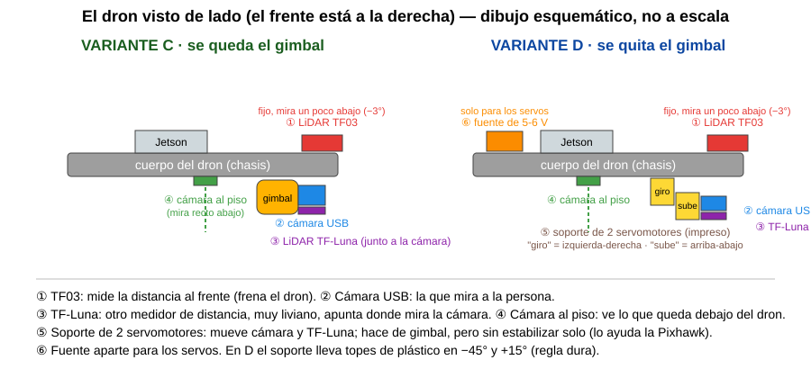

# Guía para Brahian: qué cámaras y qué soporte pone el dron para el plus

Escrita el 2026-10-17. Es el resumen sencillo de `VARIANTES.md` (allí están los cálculos). Decisiones tomadas: D-055 y
D-064 (`docs/DECISIONES.md`).

## Palabras que usa esta guía

- **Chasis:** el cuerpo del dron, donde van la batería y la Jetson.
- **Gimbal:** el soporte con motores que mueve la cámara y la mantiene firme aunque el dron se incline (el BaseCam que ya tienes).
- **Servo (servomotor):** motorcito pequeño que gira a un ángulo exacto que se le ordena.
- **Pan-tilt:** soporte con dos servos: uno gira la cámara a izquierda y derecha, el otro la sube y la baja.
- **LiDAR:** medidor de distancia con luz láser. El **TF03** llega lejos pero es grueso y pesado; el **TF-Luna** llega menos (unos 8 m) y es liviano.
- **CSI:** el conector plano de cámara de la Jetson. Tiene dos entradas, CAM0 y CAM1.
- **BEC:** fuente pequeña que baja el voltaje de la batería a 5–6 V para alimentar los servos aparte.
- **Pitch:** la inclinación de la cámara hacia arriba o hacia abajo. Regla dura: siempre entre −45° y +15°.

## 1. Tus preguntas, una por una

| Pregunta | Qué hacemos | Por qué | Qué descartamos |
|---|---|---|---|
| ¿Tres cámaras, dos o una? | **Dos:** la USB que ya tienes (mira a la persona) y **una cámara CSI mirando recto al piso**. | La del piso ve lo que queda justo debajo del dron, que la principal no ve. Con dos cámaras la Jetson ya está medida: 24 y 21 imágenes por segundo, suficiente. | **La tercera:** con tres, la Jetson bajaría a unas 15 imágenes por segundo cada una (es una cuenta mía, no está medido) y casi no aporta. Queda para después si hiciera falta. |
| ¿En qué posición va cada una? | La **USB** va donde mira la persona (en el gimbal o en los servos). La **del piso** va fija bajo el dron, en el centro, con su lado largo a lo largo del vuelo. | Así su vista se une con la de la USB cuando esta mira a −45° y no queda hueco. La cámara plana no soporta que la muevan una y otra vez. | Poner la cámara del piso en el gimbal: se rompería el cable plano. |
| ¿Quitamos el gimbal o lo dejamos? | **Lo dejamos primero** (variante C). Solo lo quitamos si no baja a −45° (variante D). | Hoy solo baja hasta −10°; la sospecha es el cable grueso del TF03, que lo frena. Si es eso, arreglarlo cuesta casi nada. | Quitarlo ya, sin probar: sería gastar tiempo e impresión sin saber si hacía falta. |
| ¿Servos encima del gimbal, de un eje o de dos? | **Ni encima del gimbal, ni de entrada.** Si hay que usarlos, **reemplazan** al gimbal, con dos ejes impresos, pero al principio trabaja **solo el de subir-bajar**; el de izquierda-derecha queda quieto (D-056). | Encima del gimbal pesa más (unos 85 g) y carga unos motores pequeños que no sabemos cuánto aguantan. El dron ya gira entero hacia la persona, y la red no sabe usar el giro todavía. | Servos sobre el gimbal (variante E). Mover el giro izquierda-derecha en la V17. |
| ¿La cámara USB va en el gimbal o en los servos? | En **C**, en el gimbal. En **D**, en los servos. | Es la misma cámara; solo cambia quién la mueve. | — |
| ¿El sensor también va con los servos? | El **TF-Luna sí**: va pegado a la cámara, apunta a donde ella mira (tanto en C como en D). El **TF03 no**: va **fijo al cuerpo del dron**, mirando al frente un poco hacia abajo (−3°). | El TF-Luna pesa muy poco (≈5 g) y su cable es fino, no frena nada. El TF03 es el que ayuda a frenar: debe mirar siempre al frente. | TF03 en el gimbal (su cable es lo que lo traba). |
| ¿Solo cambiamos el LiDAR y vemos si el gimbal mueve la cámara? | **Sí, es exactamente el plan.** | Es la prueba más barata y decide todo lo demás. | — |

## 2. Dónde va cada cosa

Archivo del dibujo: [`dibujo_C_y_D.svg`](dibujo_C_y_D.svg). Es un esquema, no está a escala.

## 3. El orden de las pruebas en el campo

Las hace **la parte física**, después de terminar los pasos 4 a 7 del mínimo. Esta sesión no toca el dron.

1. **Pesar** el dron completo y, por separado, el gimbal BaseCam, el TF03 y la cámara USB (hoy solo sabemos que el dron pesa 2 371 g).
2. **Prueba que decide todo: quitar el cable del TF03 del gimbal** (dejar el TF03 fuera del gimbal; si no se puede aún
   montar en el chasis, basta con tenerlo desconectado y apartado) y pedirle al gimbal bajar de a poco: −10°, −20°,
   −30° y −45°. Nunca más allá de −45°. Anotar el ángulo real que alcanza.
   - **Si baja a −45°: variante C.** Montar el TF03 en el chasis (−3°), el TF-Luna junto a la cámara y la cámara CSI al piso. Como el TF03 cambia de lugar, **primero se vuelve a simular el mínimo** con esa posición.
   - **Si no baja: variante D.** Montar el pan-tilt impreso con los dos servos, la fuente aparte y los topes de plástico, y pasar el pitch a la Pixhawk (ella lo estabiliza).
3. **En banco, sin hélices** (solo variante D): servos con su fuente aparte, medir el recorrido real y comprobar que el tope de plástico para el soporte antes de −45° y de +15°.
4. **Cámara del piso** (en C y en D): conectarla, comprobar que se ve en la Jetson y medir su campo de visión real (hoy solo existe el valor del fabricante, 62.2°).
5. **Vuelo corto atado o a muy poca altura**, para ver que el peso extra no cambia el equilibrio, y volver a probar el freno por LiDAR.

Todo lo anterior queda como pedido en `docs/PEDIDOS_A_LA_PARTE_FISICA.md`.

## 4. Imprimir el pan-tilt de la variante D

**Estado: las piezas ya compilan y están en `piezas_3d/stl/`** (ver `piezas_3d/ESTADO_IMPRESION.md`). En la computadora
comprobé que los topes de plástico paran la cuna en −44° y +14° (1° antes del límite de la regla dura). **Lo que no se
puede saber sin el servo en la mano** son las medidas reales (hay que probar que el MG90D entre) y la tolerancia de tu
impresora. Por eso: **imprime primero solo la plataforma** y prueba el servo antes de seguir.

Parámetros de impresión propuestos (de mi criterio, sin haber impreso):

| Qué | Valor |
|---|---|
| Material | PETG (o PLA+ si no tienes PETG; el PLA común se ablanda con el sol) |
| Altura de capa | 0.2 mm |
| Paredes | 3 |
| Relleno | 35 % |
| Soportes | probablemente ninguno si se imprimen como indica `parte` en el archivo; se confirma con el programa de corte |
| Piezas | 3: base, plataforma, cuna (más los soportes de cámara y de LiDAR, que también están en `stl/`) |
| Peso estimado | ≈ 35 g en total |
| Orden | Imprime primero **una sola pieza** y mide: el agujero del servo, el ancho de la cuna y la distancia de los tornillos |

## 5. Lista de compra para la variante D (precios aproximados)

Los precios son **de memoria, en dólares, sin comprobar**, salvo donde se indica. Confirma en la tienda.

| Qué | Cantidad | Precio aprox. | Nota |
|---|---|---|---|
| Servo MG90D (engranes metálicos) | 3 (2 + 1 de repuesto) | 3–6 USD c/u | Mejor que el SG90 de plástico |
| Fuente BEC de 5 a 6 V y **3 A o más**, que acepte batería 4S | 1 | 5–10 USD | Solo para los servos; tierra común con la Pixhawk |
| Condensador de 1000 µF, 10 V | 1 | 1 USD | Evita que los servos reinicien la fuente |
| Tornillos M2 autorroscantes, surtido | 1 caja | ≈ 5 USD | Servo y cuerno |
| Tornillos M3 con tuerca de seguridad | 1 caja | ≈ 5 USD | Placa al chasis |
| Filamento PETG | 1 kg (se usan unos 40 g) | ≈ 20 USD | |
| Arandelas o gomas blandas antivibración | 1 juego | ≈ 5 USD | |
| Cables de extensión para servo | 2 | 2–3 USD | |
| **Para el resto de la variante C/D:** TF-Luna | 1 | 20–25 USD | |
| Cámara IMX219 para Jetson + cable plano de 15 a 22 pines | 1 + 1 | 15–25 + 5–8 USD | Revisar que sea compatible con la entrada de la Jetson |
| Adaptador USB-serie para el TF-Luna | 1 | 3–5 USD | Puede exigir compilar un driver, como el del TF03 |

## 6. ¿Hay diseños gratis que sirvan?

Busqué uno (una sola búsqueda; **no vi sus archivos, solo las descripciones**):

| Opción | Qué es | Frente al nuestro |
|---|---|---|
| [Pan-tilt para servos MG90S (jpralves.net)](https://jpralves.net/post/2024/05/30/pan-tilt-assembly-for-mg90s-servos.html), [Hackster](https://www.hackster.io/TheSmallWonder/pan-tilt-assembly-for-mg90s-servos-da32c6) | Diseño gratis e impreso por su autor (relleno 20 %, tornillos M2.2). | Probablemente más sencillo y probado, pero **sin topes mecánicos en −45°/+15°** ni sitio para el TF-Luna; hay que mirar si soporta nuestro peso. |
| [Kit de soportes de plástico para MG90S (Shillehtek, 3.99 USD)](https://shillehtek.com/products/pan-tilt-servo-bracket-kit-sg90-mg90s) | Soporte comprado, listo. | Sirve para probar los servos en banco, pero tampoco tiene topes y algunos solo aceptan cámaras de 28×28 mm. |
| [ESP32 Cam Pan and Tilt (Printables)](https://printables.com/model/148269-esp32-cam-pan-and-tilt-camera/files) | Pensado para otra cámara. | No sirve para nuestra carga. |

**Conclusión:** el nuestro es el único que garantiza la regla dura del pitch con topes de plástico y lleva la cámara y el
TF-Luna. El de jpralves es un buen respaldo para probar los servos en la mesa mientras se imprime el nuestro.
