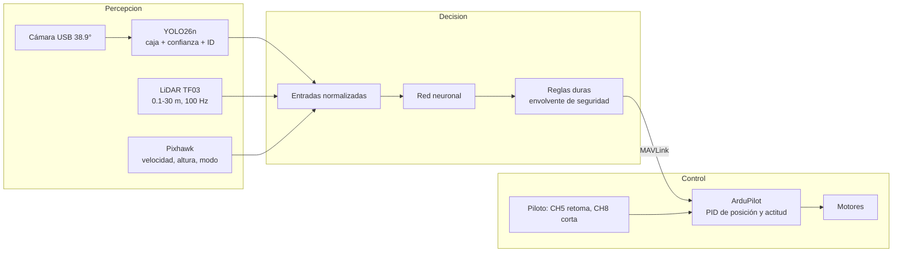
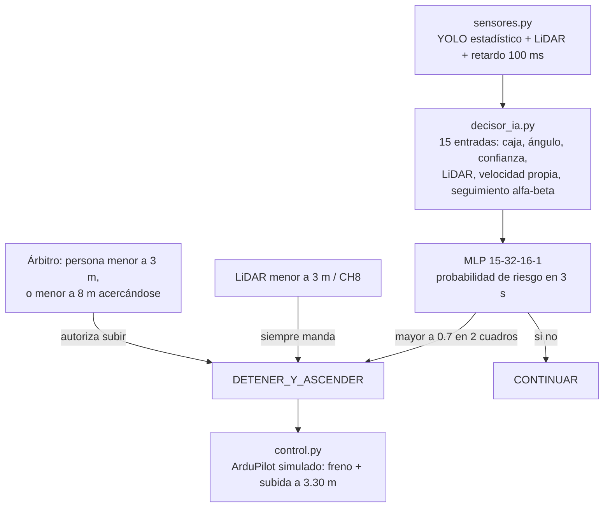
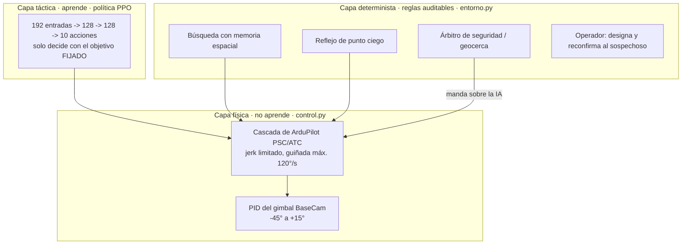
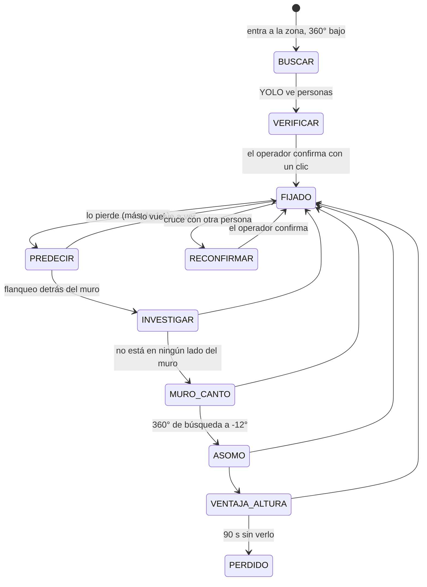
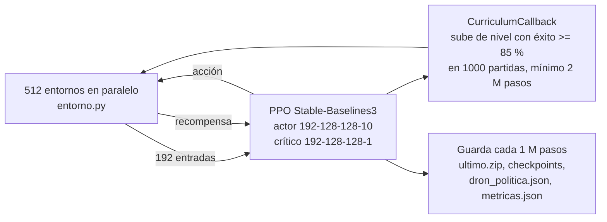

# Cómo funciona el código

Explicación en lenguaje sencillo, de lo general a lo particular. Cada cifra lleva el archivo de donde sale.

## 1. La idea general: Percepción → Decisión → Control

Todo el sistema, real o simulado, sigue tres pasos en cada cuadro (30 por segundo en la Jetson):

1. **Percepción:** qué hay alrededor. La cámara + YOLO dicen "hay una persona aquí, de este tamaño"; el LiDAR dice
   "hay algo a 7.3 m al frente"; la Pixhawk dice a qué velocidad y altura va el dron.
2. **Decisión:** qué hacer. En el mínimo, el decisor MLP elige entre CONTINUAR y DETENER_Y_ASCENDER. En el plus, la
   política PPO elige una de 10 acciones.
3. **Control:** hacerlo. La Jetson manda una orden por MAVLink y **ArduPilot** (sus PID) mueve los motores. La IA
   nunca toca los motores directamente: esa es la regla dura 6.

## 2. El mínimo indispensable (`03_SIMULACION_RL/minimo_tesis/`)

**Qué simula:** un dron que avanza en línea recta (lo maneja el piloto), una persona o un panel, sensores con ruido y
100 ms de retardo, y una lógica que solo frena y sube a 3.30 m ante un riesgo definido. No usa `entorno.py`: es
independiente y está congelado.

- **Riesgo definido** (`minimo_tesis/README.md`): obstáculo que no alcanza la distancia de frenado + margen, o a
  menos de 2.5 s, o a menos de 3 m; persona a menos de 3 m, o a menos de 8 m acercándose con trayectoria que pasa a
  menos de 2 m.
- **El decisor** (`decisor_ia.py`): aprende de vuelos simulados **etiquetados automáticamente** con la verdad del
  simulador ("¿en 3 s habría choque o persona a menos de 2 m?"). Nadie etiqueta a mano. 1057 parámetros
  (`ver_redes.py`).
- **Protocolo del comité** (`protocolo_comite.py`): escenarios a-e con semillas fijas, 100 vuelos por variante, con y
  sin sistema. Salida en `informes/minimo_tesis_protocolo.md`.

## 3. El plus: la IA de refuerzo (`03_SIMULACION_RL/`)

### 3.1 Tres capas

### 3.2 El mundo simulado (`entorno.py`)

- **Vectorizado en NumPy:** simula cientos de partidas a la vez (`EntornoDronPersona(n)`), paso de 0.1 s (`DT`).
- **Arena** de 25 m (`ARENA`), muros de 0.2 m de grosor, 0-2 civiles y un **ladrón táctico** (red propia congelada,
  `ladron_congelado.pt`, más reglas: huye, se esconde detrás de los muros, ataca desde el nivel 2, se cansa).
- **Sensores:** cámara de 38.9° con YOLO estadístico (probabilidad según distancia, oclusión, detección parcial con
  el 15 % del cuerpo); LiDAR de 10 rayos por paso hasta 30 m; Kalman y filtro de partículas para predecir dónde está
  el ladrón cuando no se ve.
- **Mapa LiDAR propio** (D-011): cada impacto es un punto; los puntos se agrupan en muros. El dron no usa el plano del
  simulador.
- **Las 192 entradas de la red** (`OBS_DRON = 21 + 7 + 8 + 2 + 10 + 144`): personas a la vista, memoria espacial
  (última posición, tiempo sin verlo), 8 sectores del LiDAR, predicción, estado propio del dron y una grilla de
  12 × 12 celdas de 1.5 m del mapa descubierto. Se calculan en `_sensores()`.
- **Las 10 acciones** (`CLASES`): MANTENER, EVADIR_IZQ, EVADIR_DER, DETENER_ASCENDER, GIRAR_IZQ, GIRAR_DER, AVANZAR,
  DESCENDER, GIMBAL_ARRIBA, GIMBAL_ABAJO.

### 3.3 Máquina de estados de búsqueda (regla dura 3: determinista)

Resumen simplificado (el orden exacto está en el docstring de `entorno.py`, V12 y V15 fase D). Solo en **FIJADO** decide la red (`mascara_decision()`); en el resto mandan las reglas.

### 3.4 Recompensas (`entorno.py`, constantes `R_*` y `K_*`)

| Qué | Valor | Para qué |
|---|---:|---|
| Ver al objetivo, por paso | +0.03 (`R_VISTA`) | Mantenerlo a la vista |
| Estar a 3.5-5 m | +0.02 (`R_RANGO`) | Distancia óptima |
| Estar a menos de 3 m | −0.02 (`R_MUY_CERCA`) | No sobrevolarlo |
| Re-adquirirlo tras perderlo más de 1 s | +8 (`R_DESCUBRE`) | Buscar bien |
| Perderlo más de 1 s | −8 (`R_PIERDE`) | Igual y opuesto: perder a propósito no rinde (D-022) |
| Misión cumplida (rendición) | +5 + 0.25 por segundo sobrante | Terminar pronto |
| Tope de 5 min sin rendición | −5 (`R_TOPE`) | Derrota |
| Chocar con persona / panel / salir de la geocerca / perderlo | −10 / −5 / −5 / −5 | Seguridad |
| Sacudidas de los mandos | −0.15·Σ\|Δu\| −0.03·Σ\|u\| | Vuelo suave (solo lo que manda la red) |
| Guía hacia el objetivo | potencial, γ 0.99 | Ayuda a aprender (no cambia la solución óptima) |

## 4. Cómo se entrena (`entrenar_master.py`)

- **PPO** (`entrenar_master.py`, línea ~197): `n_steps=128`, `batch_size=8192`, `n_epochs=4`, `gamma=0.99`,
  `gae_lambda=0.95`, `clip_range=0.2`, **`ent_coef=0.01`**, `vf_coef=0.5`, tanh, en CPU (torch 2.14.1+cpu).
- **Transferencia:** cada versión arranca del último checkpoint de la anterior (V10 → V12 → V14 → V15), en vez de
  aprender desde cero.
- **Currículo V15** (5 niveles, `NIVELES`): Duelo abierto, Duelo con civil, Muro, Muro y civil, Misión completa;
  25 % de las partidas repasan niveles anteriores. La V15 llegó al nivel 4 a los 24.4 M pasos y se quedó ahí hasta
  229.4 M (`modelos_v15/estado_entrenamiento.json`).
- **El ladrón no aprende** durante la V15 (congelado).

### Dónde quedan las redes

| Archivo | Qué es |
|---|---|
| `modelos_v15/ultimo.zip` | La política más reciente (se sobrescribe a cada rato mientras entrena) |
| `modelos_v15/checkpoints/dron_master_N_steps.zip` | Una copia por millón de pasos, para volver atrás |
| `modelos_v15/base_v15.zip` | De dónde arrancó la versión |
| `modelos_v15/estado_entrenamiento.json` | Iteración, pasos, nivel e historia del currículo |
| `modelos/dron_politica.json` | Los pesos del actor en JSON, para la Jetson |
| `salida/metricas.json` | Historia del entrenamiento por iteración (la leen el visor y `resumir_metricas.py`) |
| `minimo_tesis/decision.pkl` / `.json` | El decisor del **mínimo** (no es del PPO) |

## 5. Lo que hay que saber con honestidad (2026-10-16)

- La política PPO de la V15 decide **casi al azar**: su acción preferida tiene en promedio 0.17 de probabilidad (al
  azar sería 0.10) y la entropía es 2.14 de 2.30 (`ver_redes.py`, misión de ejemplo de 90 s; el resumen del
  entrenamiento da 2.12, `informes/resumen_v15-231M.md`). Los buenos resultados vienen sobre todo de las reglas
  deterministas alrededor. El diagnóstico y el plan para corregirlo van en la Fase C (`docs/PLAN_V17_REFUERZO.md`).
- El **mínimo no depende del PPO**: su decisor sí aprendió (en los cuadros de prueba coincide con la etiqueta el
  96.8 % de las veces por cuadro, `ver_redes.py`).
