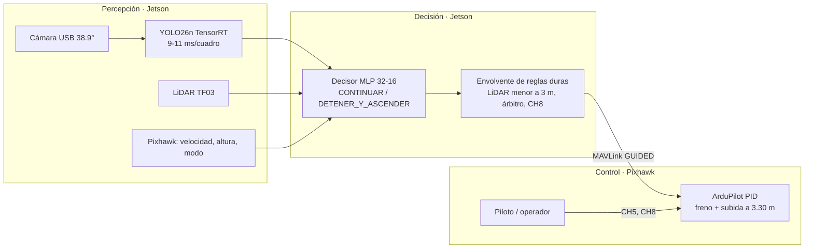

# Dron IA · detección de personas, evasión y vigilancia

Proyecto de grado de Ingeniería Aeronáutica (Universidad de San Buenaventura) de **Brahian Andrés Orrego Osorio**.
Un cuadricóptero con **Jetson Orin Nano** y **Pixhawk (ArduPilot 4.7)** que detecta personas con YOLO, mide
obstáculos con un LiDAR y decide con una red neuronal cuándo frenar y subir. Como trabajo complementario, una IA
entrenada por refuerzo aprende a **mantener a la vista a un sospechoso** en simulación.

> Esta es la portada provisional de la carpeta de trabajo (2026-10-16). La versión completa, con fotos, gráficas e
> historial V1-V17, se escribe en la Fase E antes de crear el repositorio público.

## Arquitectura

## Mínimo indispensable vs. plus

| | Mínimo indispensable (lo que pide el comité) | Plus (trabajo complementario) |
|---|---|---|
| Qué hace | El piloto avanza; el sistema solo **frena y sube a 3.30 m** ante un riesgo definido | El dron busca, sigue y mantiene a la vista a un sospechoso que huye |
| IA | YOLO26n (preentrenada) + decisor MLP | Política PPO (Stable-Baselines3) + reglas deterministas |
| Estado | Simulación terminada y congelada; falta la parte física (pasos 4-7) | V15 detenida en 230.7 M pasos; V16 programada en la nube, sin entrenar |
| Carpeta | `01_MINIMO_INDISPENSABLE/` (congelada) | `03_SIMULACION_RL/` |

Resultados del mínimo en simulación (`03_SIMULACION_RL/informes/minimo_tesis_protocolo.md`): 1300 vuelos del
protocolo, éxito 100 % [99.7, 100], 0 activaciones falsas en 300; con el operador solo, 23 % de vuelos seguros.

## Carpetas

| Carpeta | Contenido |
|---|---|
| `01_MINIMO_INDISPENSABLE/` | Copia congelada del mínimo (código, decisor, informes, scripts de a bordo) |
| `02_JETSON_A_BORDO/` | Código que corre en la Jetson |
| `03_SIMULACION_RL/` | Simulación, entrenamiento PPO, visor 3D, pruebas e informes |
| `04_VISOR_Y_MOTOR_GRAFICO/` | Plan del visor y del motor gráfico (el visor vigente está en la 03) |
| `05_HARDWARE_Y_VARIANTES/` | Hardware, Pixhawk, Jetson y variantes |
| `06_REDES_NEURONALES_Y_MODELOS/` | `ver_redes.py` e índice de modelos |
| `07_DOCUMENTO_PROYECTO_DE_GRADO/` | **Privado**: documento y cartas del comité |
| `08_EVIDENCIA_Y_DIAGRAMAS/` | Fotos, diagramas y gráficas |
| `docs/` | Estado, bitácora, decisiones y planes |

Guías: `GUIA_DE_ARCHIVOS.md` (qué es cada archivo), `COMO_FUNCIONA_EL_CODIGO.md` (cómo está construido) y
`DEMOSTRACION_PARA_EL_INGENIERO.md` (guion de 10 minutos).

## Reglas duras

Gimbal entre −45° y +15° · geocerca · búsqueda determinista al perder el objetivo · humano en el lazo (el operador
confirma al sospechoso) · árbitro de seguridad (el LiDAR < 3 m y la parada CH8 mandan sobre la IA) · la red no
estabiliza nada. Detalle en `CLAUDE.md`.
