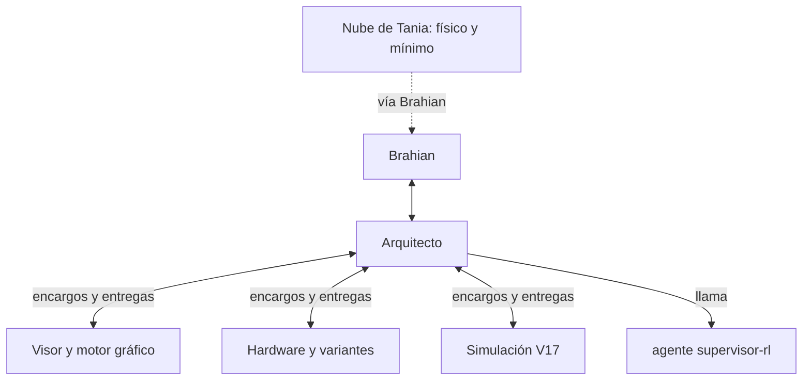

# Equipo de sesiones · tablero

Desde el 2026-10-16. Cada sesión **lee este archivo al empezar** y **actualiza su fila al cerrar** (con `/cierre-sesion`).

## División entre las dos cuentas

| Cuenta | Dónde | Qué trabaja |
|---|---|---|
| Tania (nube de claude.ai) | Conversación en la nube | **Parte física** del dron, **mínimo indispensable** y **documento** del proyecto de grado |
| Brahian (esta app, Claude Code) | Carpeta `Dron-IA-Proyecto` | **Simulación y plus**: entorno, entrenamiento, motor gráfico, interfaz, variantes de hardware en simulación |

Por eso, aquí: **no se usa SSH con la Jetson, no se toca `01_MINIMO_INDISPENSABLE/`, `02_JETSON_A_BORDO/` ni
`07_DOCUMENTO_PROYECTO_DE_GRADO/`**. Lo que se aprenda en campo llega por Brahian.

## Sesiones

| Sesión | Rol | Modelo / esfuerzo | Es dueña de | Estado |
|---|---|---|---|---|
| **Arquitecto** | La cabeza: ordena las ideas de Brahian, decide el plan V17, reparte encargos, revisa lo que entregan las otras y lleva las decisiones a Brahian | Opus · alto | `docs/` (planes, decisiones, este tablero) | Plan V17 entregado el 17-oct (`docs/PLAN_V17_REFUERZO.md`, diagnóstico en `03_SIMULACION_RL/informes/diagnostico_v17_ia_aporta.md`). Espera que Brahian apruebe D-049 a D-054 |
| **Visor y motor gráfico** | Trae el visor V16 al PC, mide los cuadros por segundo, compara three.js / Unreal 5 / Godot-Unity y diseña la interfaz de la estación de tierra | Opus · alto para decidir | `04_VISOR_Y_MOTOR_GRAFICO/` | Activa |
| **Hardware y variantes** | Matriz de variantes (cámaras, gimbal o pan-tilt, LiDAR), piezas 3D en OpenSCAD y su configuración para la simulación | Sonnet · medio | `05_HARDWARE_Y_VARIANTES/` | Por abrir |
| **Simulación V17** | Implementa en `entorno.py` y el entrenamiento lo que el Arquitecto y Brahian aprueben, con pruebas | Opus o Sonnet | `03_SIMULACION_RL/` | Por abrir: encargo listo en `docs/ENCARGO_SIMULACION_V17.md` (empieza cuando Brahian apruebe D-049 a D-054) |

**Supervisor:** no es una sesión aparte. Es el agente `supervisor-rl` (`.claude/agents/`), que el Arquitecto llama
después de cada entrenamiento o cada vez que haya un resumen nuevo (`herramientas/resumir_metricas.py`). Diagnostica y
propone máximo 3 cambios; no toca código. Mientras un entrenamiento corre, el Arquitecto programa una revisión cada
pocas horas (no vigila en bucle: entrenar no gasta tokens).

## Cómo se comunican

- Las sesiones hablan con el **Arquitecto** por mensajes (`SendMessage` con su id `local_…`, en la tabla de abajo) y
  dejan lo largo en archivos de su carpeta.
- El Arquitecto **no aprueba solo** lo importante: lo lleva a Brahian (decisiones en `docs/DECISIONES.md`).

## Reglas para todas

1. Máximo **2 sesiones trabajando a la vez** (límite semanal del plan).
2. Cada una escribe **solo en su carpeta**; si necesita cambiar algo de otra, se lo pide al Arquitecto.
3. Commits solo de sus propios archivos; **nunca `git push`** sin que Brahian lo confirme en el chat.
4. **No se lanza ningún entrenamiento largo** sin aprobación de Brahian.
5. Reglas duras de `CLAUDE.md` y cifras con su fuente, siempre.
6. Español sencillo con Brahian; "proyecto de grado", nunca "tesis".

## Ids de las sesiones

| Sesión | Id |
|---|---|
| Arquitecto | `local_a88942b1-0fa7-4d2c-ad06-c18f47cdb352` |
| Visor y motor gráfico | `local_1ade7139-ae14-476c-917f-8957fafb96ba` |
