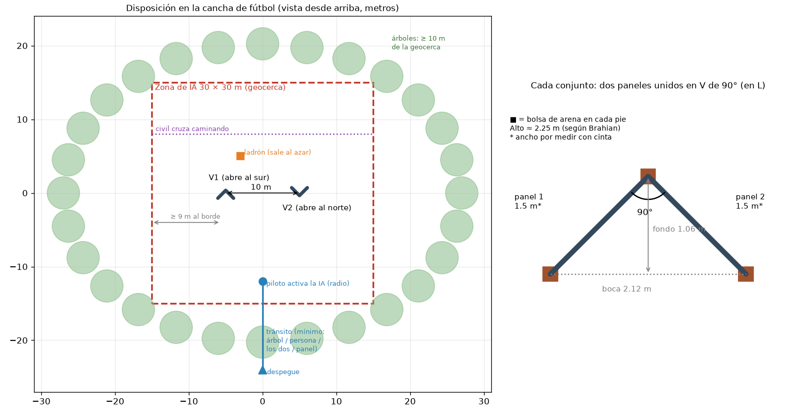

# Plan V17 · Que la IA de refuerzo aporte de verdad, en la misión real de la cancha

Arquitecto, 2026-10-17. **Solo plan: no se ha cambiado el entorno ni se ha entrenado nada.** Brahian aprobó las decisiones nuevas
(D-049 a D-054, `docs/DECISIONES.md`) el 17-oct. Base: `docs/IDEAS_BRAHIAN_2026-10-16.md`,
`docs/PLAN_V16_REALISMO.md` y lo que ya programó la V16 en la rama `v16-simulacion` (repo viejo, `docs/PROGRESO_V16.md`).

## 0. En cinco líneas (para Brahian)

1. **Medido: la IA de la V15 no aporta nada.** Rinde igual que "quedarse quieto siempre" y que decidir al azar; 222 M pasos
   de entrenamiento no movieron ningún número. Lo bueno que se ve lo hacen las reglas (sección 1).
2. **La causa no es "entrenar poco":** de sus 10 botones, 9 hacen lo mismo cuando ve al ladrón. La V17 le da **7 botones
   que sí cambian algo** (rodear, acercarse, alejarse, subir, bajar, quedarse) y deja todo lo de seguridad en reglas.
3. **"La IA aporta"** = gana, con margen medible, a "solo reglas", al azar **y** a una regla de posicionamiento bien
   pensada, sin empeorar la seguridad (sección 2).
4. **Paneles:** miden ~2.0 m de alto (estimado en la foto). Cada conjunto en **V de 90° (en L)**; las dos V a **10 m**
   entre vértices, con las bocas hacia lados contrarios, en una zona de **30 × 30 m** en media cancha, a 10 m o más de los
   árboles (dibujo en la sección 3).
5. Entrenar en tramos: 10 M pasos (~2.3 h) por cada regla para decidir si se queda, luego 50 M (~11 h) con todo; **si a
   los 50 M no le gana a "solo reglas", se para** y se diagnostica, en vez de quemar 200 M como la V15.

## 1. Diagnóstico medido de la V15

Informe completo: `03_SIMULACION_RL/informes/diagnostico_v17_ia_aporta.md`. Lo esencial:

| Misión completa, nivel 4, 256 partidas de 5 min | Cumplida | Custodia ≥ 60 s | Vista total (s) |
|---|---:|---:|---:|
| V15 a los 229 M pasos | 33.2 % | 11.3 % | 99 |
| V15 al empezar (7 M) | 35.2 % | 13.7 % | 98 |
| Solo reglas (siempre MANTENER) | 34.0 % | 10.2 % | 98 |
| Al azar | 32.8 % | 7.8 % | 96 |

Margen de error ±5.8 y ±3.9 puntos: las cuatro filas son iguales. En los escenarios fijos pasa lo mismo, y el barrido de
checkpoints de la V15 (`informes/barrido_v15.md`, rehecho con `modelos_v15`) es plano: 0.96-0.97 de media de 7 a 230 M.

Por qué la entropía no baja (medido en 41 641 decisiones reales y leído en `entorno.py`):
1. **Acciones redundantes.** Con el ladrón a la vista y sin amenaza solo AVANZAR cambia algo; las otras 9 son "quedarse".
   La red aprendió a no avanzar (probabilidad 0.002, y con razón: avanzar siempre baja la custodia a 0 %) y reparte el resto
   parejo: eso da entropía ≈ ln 9 = 2.20 (medido 2.11).
2. **El 57 % del lote es ruido:** la red decide en el 43 % de los pasos, pero PPO aprende de todos.
3. **El bono de entropía (0.01)** es lo único que empuja cuando las acciones dan igual: la entropía sube sola.
4. **Riesgo:** la maniobra de evasión ante una amenaza la elige la red. Hoy salva el reflejo del árbitro; en la V17 la
   evasión debe ser una regla.

No es un problema de normalización de observaciones ni de "currículo que sube rápido": aunque todo eso fuera perfecto, una
red cuyos botones no cambian nada no tiene nada que aprender.

## 2. Qué significa "la IA aporta" (medible)

Se mide con `herramientas/medir_ia_aporta.py` (misión completa V17, **512 partidas** de 5 min, mismas semillas para
todas las políticas) y con los escenarios fijos de la V16 (`evaluar_politica.py --escenarios v16`).

**Métricas**
- **M1 · Custodia (principal):** % de partidas con 60 s seguidos o más con el ladrón a la vista y el ID correcto.
- **M2 · Re-adquisición tras el panel:** % de pérdidas que se recuperan en ≤ 10 s, y tiempo medio.
- **M3 · Rendición:** % de partidas en que el ladrón se rinde (contador continuo de la V15).
- **Seguridad (no puede empeorar):** alcanzado, choques con personas y paneles, geocerca, gimbal fuera de −45..+15°,
  altura < 3.30 m con alguien a < 8 m. Las reglas duras de `CLAUDE.md` siguen siendo pruebas que no se relajan.

**Contra qué se compara (las mismas reglas debajo, cambia solo quién elige los botones)**
- **B0 · Solo reglas:** siempre QUEDARSE.
- **B1 · Azar.**
- **B2 · Regla de posicionamiento:** en cada paso elige el botón que más sube la cobertura (fracción del área a la que el
  ladrón llega en 2.5 s que el dron ve; el mismo cálculo que `K_COB` de la V16). Es la mejor regla que un ingeniero
  escribiría a mano. Hay que programarla (encargo, sección 7).

**Criterio**
- **Aporta:** M1 de la política ≥ M1 de B0 y de B1 + 5 puntos (con 512 partidas el margen de error es ~±3), M2 y M3 no
  peores fuera del ruido, seguridad igual.
- **Aporta más que una regla diseñada:** lo mismo contra B2. Si gana a B0 y B1 pero empata con B2, el resultado honesto
  para el documento es "la IA aprendió sola lo que una regla geométrica bien pensada hace", que también es defendible.
- Además, como descripción (no como criterio): probabilidad de la acción preferida ≥ 0.5 en promedio y entropía
  ≤ 60 % del máximo en los estados donde decide.

Hoy, la V15 **no aporta** (sección 1).

## 3. La misión V17 y la cancha

### 3.1 Fases de la misión (lo que pidió Brahian)

| Fase | Quién manda | Qué pasa | ¿Entra al entrenamiento? |
|---|---|---|---|
| 1 Despegue | Piloto | Despega y sube | No |
| 2 Tránsito | Piloto + **mínimo** | Árbol, persona, los dos o un panel en el camino: el mínimo frena y sube a 3.30 m (`minimo_tesis/`, congelado) | No: se muestra en la misión del visor (`mision.py`) con el sistema del mínimo tal cual |
| 3 Activación | Piloto | En la zona, el piloto activa la IA con un interruptor de la radio (propuesta: **CH7**; CH8 sigue siendo la parada de emergencia) | Aquí **empieza** cada partida de entrenamiento |
| 4 Zona de IA | Reglas + IA | 360° de entrada, búsqueda, el operador confirma al sospechoso con un clic **en el computador**, seguimiento; si lo pierde, búsqueda determinista (regla 3) | Sí (la red solo decide con el objetivo fijado) |
| 5 Fin | — | Rendición, tope de 5 min, o el piloto desactiva la IA | Sí |

Entrenar solo desde la activación evita gastar pasos en lo que la red no decide (D-053). El interruptor CH7 es del lado de
la Jetson (`02_JETSON_A_BORDO/`, no se toca aquí): queda anotado para la nube de Tania.

### 3.2 Los paneles: altura medida en la foto

> **Actualización (17-oct, D-066):** Brahian, que conoce los paneles, dice que cada uno mide **~1.5 m de ancho** y el
> conjunto **~2.2-2.3 m de alto** ("al menos 50 cm por encima de mi cabeza", él mide 1.74 m). Eso manda sobre la
> estimación de la foto de abajo. Nuevos valores hasta medirlos con cinta: **`ANCHO_PANEL_V17 = 1.5` m y
> `ALTO_PANEL_V17 = 2.25` m (aleatorio 2.1-2.4 m)**. La V de 90° queda con boca de 2.12 m y fondo de 1.06 m. Las dos V a
> 10 m y la zona de 30 × 30 m no cambian. Desde 3.30 m y a 5 m del panel, una persona de pie queda oculta hasta ~2.6 m
> detrás y agachada hasta ~5.5 m: ver por encima ahora pesa más (SUBIR).

Foto `08_EVIDENCIA_Y_DIAGRAMAS/paneles_de_exposicion_universidad.png` (330 × 572 px). Referencia: la mujer de la
derecha, de pie a una distancia parecida a la del panel del fondo, con los pies a la vista. Con el método del horizonte
(alto = altura de la cámara × (y_pie − y_cabeza) / (y_pie − y_horizonte); horizonte a la altura de los ojos, y ≈ 165):

| | Pie (px) | Arriba (px) | Alto relativo a la cámara |
|---|---:|---:|---:|
| Mujer de la derecha | 462 | 140 | 1.08 |
| Panel del fondo (marco) | ~445 | ~44 | 1.43 |

Si la mujer mide 1.58 m (estatura media de una mujer adulta colombiana, aproximada), la cámara estaba a ~1.46 m y el
**panel mide ~2.1 m**. Con las incertidumbres (horizonte ±10 px, estatura ±5 cm, base del panel) sale entre **1.9 y
2.2 m**. **Parámetro: `ALTO_PANEL_V17 = 2.0` m, aleatorio entre 1.9 y 2.2 m en el entrenamiento.** El ancho de cada panel
no se puede medir en la foto (se ve de lado): **`ANCHO_PANEL_V17 = 1.0` m provisional; Brahian lo mide con cinta** el día
que los pida (y el alto, para cerrar el parámetro).

Consecuencias que cambian la simulación (hoy los muros son de 4-6.5 m de largo y 2.6 m de alto):
- **Los paneles reales son cortos.** Una V de dos paneles de 1 m tapa ~1.4 m de frente: alcanza para esconder a una
  persona, no para correr detrás. La búsqueda "muro de canto" (D-044) se diseñó para muros largos; con V cortas lo natural
  es **rodear la V** a 4-5 m. La sesión de simulación lo mide y ajusta (sigue siendo determinista, regla 3).
- **Desde 3.30 m se ve por encima.** Con el dron a 3.30 m y 5 m del panel, la línea que roza el borde superior (2.0 m)
  baja 1.3 m cada 5 m: una persona **de pie** (cabeza a 1.7 m) solo queda oculta hasta ~1.2 m detrás del panel; **agachada**
  (1.1 m), hasta ~3.5 m; **gateando** (0.6 m), hasta ~5.4 m. Subir y bajar dentro de lo permitido es una decisión táctica
  real: por eso SUBIR y BAJAR son botones de la red en la V17.
- **El LiDAR horizontal pasa por encima.** El TF03 a 3.30 m mirando al frente no ve paneles de 2.0 m. En el 360° de
  entrada (2.5 m, −3°) el rayo baja de 2.0 m recién a los ~9.5 m: los paneles más cerca de 9.5 m no se mapean. Hay que
  re-medir la altura y el pitch del 360° de entrada (encargo de simulación) y avisarle a la sesión de hardware (encargo 7.3).

### 3.3 Disposición recomendada (para montar en la cancha)



- **Ángulo de cada V: 90° (en L).** Con dos paneles de ancho w, la V a 90° es la de **mayor área de apoyo** (½·w²·sen θ es
  máxima en 90°): es la que menos se cae. Frente tapado 1.41·w, fondo 0.71·w. A 60° tapa solo 1.0·w; a 120° el fondo baja a
  0.5·w y se cae más fácil. Para armarla: una escuadra, o una cuerda con nudos 3-4-5 (30-40-50 cm) en la unión.
- **Bolsas de arena** en los tres pies de cada V (las dos puntas y la unión). En una cancha abierta un panel de 2 m es una
  vela: con viento fuerte, no se vuela.
- **Distancia entre las dos V: 10 m** entre vértices. Así el dron a la distancia de seguimiento (4-5 m) **no puede ver las
  dos a la vez** (la cámara de 38.9° cubre ~3.2 m de ancho a 4.5 m) y el ladrón tarda ~3 s corriendo (3.3 m/s en la
  simulación) en cambiar de escondite: hay una decisión real de dónde ponerse.
- **Bocas hacia lados contrarios:** V1 abierta al sur (hacia donde entra el dron), V2 abierta al norte. El escondite de una
  se ve desde un lado y el de la otra desde el lado opuesto.
- **Zona de IA de 30 × 30 m** en el centro de media cancha, con las V en el medio (≥ 9 m a cada borde, para poder rodearlas
  a 5 m sin tocar la geocerca) y **≥ 10 m de los árboles**. La geocerca de ArduPilot se ajusta a esa zona. En la simulación
  la arena pasa de 50 × 50 m (`ARENA = 25`, medio lado) a 30 × 30 m (D-051).
- **Civil:** cruza caminando de un lado al otro, por ejemplo a 8 m de la línea de las V.
- **Tránsito:** desde el despegue (fuera de la zona) hacia el punto de activación, pasando junto a un árbol del borde de la
  cancha o con una persona que cruza (el mínimo actúa ahí).
- **Ojo para el mínimo (nube de Tania, vía Brahian):** frenar y **subir a 3.30 m debajo de la copa de un árbol** puede
  meter el dron entre las ramas. Para el árbol del tránsito conviene uno con la copa por encima de ~4.5 m, o que ante un
  árbol el mínimo solo frene.

La cancha cerrada de colores queda como alternativa (sin árboles; la cámara sobre piso de colores es otra prueba de YOLO).

## 4. Cambios de base de la V17 (no son opcionales: sin ellos la IA no tiene qué aprender)

| # | Cambio | Por qué |
|---|---|---|
| E1 | Partir del código de la **V16** (rama `v16-simulacion` del repo viejo: posturas, salto, civiles curiosos, cámara al piso, coberturas, sacudida, `medir_v16.py`, escenarios de 2 paneles) traído a `03_SIMULACION_RL/` | Ya está programado y probado (118 pruebas en esa rama); no se reinventa |
| E2 | **Botones de la red con el objetivo fijado (D-049):** QUEDARSE, RODEAR_IZQ, RODEAR_DER (órbita a 1.5 m/s alrededor del ladrón, la `ORBITA_V16` ya escrita), ACERCARSE (a 3.5 m), ALEJARSE (a 6 m), SUBIR (+0.5 m, hasta 5.5 m), BAJAR (−0.5 m, nunca bajo 3.30 m con alguien a < 8 m) | Siete botones y cada uno cambia algo. Guiñada, gimbal, árbitro, geocerca, alturas mínimas y búsqueda siguen en reglas |
| E3 | La **maniobra de evasión la elige el árbitro** (regla, como en los modos automáticos), no la red | Regla dura 5; hoy una red al azar casi nunca la confirma (sección 1) |
| E4 | **Máscara de acciones (D-050):** `MaskablePPO` de `sb3-contrib` (misma versión que SB3). En los pasos donde la red no decide queda un solo botón permitido (no cuenta para aprender ni para la entropía) y nunca se ofrecen botones prohibidos (p. ej. BAJAR con alguien cerca) | Quita el 57 % de ruido del lote y la entropía falsa. Es una dependencia nueva: la aprueba Brahian |
| E5 | Partidas que **empiezan en la activación** (D-053) | No gastar pasos en el tránsito |
| E6 | **Escenario de la cancha (D-051):** zona 30 × 30 m, dos V de 90° (alas 1.0 m, alto 1.9-2.2 m) a 10 m con bocas opuestas (posición y giro del conjunto con algo de azar: ±2 m, ±20°), 1 ladrón y 1 civil, piso de césped | Es lo que se va a montar |
| E7 | Re-medir y ajustar para paneles de 2 m: el 360° de entrada (altura y pitch del LiDAR), la búsqueda tras el panel (rodear la V en vez de muro de canto) y el stand-off | Sección 3.2 |
| E8 | Programar **B2** (regla de posicionamiento) y extender `medir_ia_aporta.py` a la misión V17 con 512 partidas | Sección 2 |

Antes de entrenar nada se miden B0, B1 y B2 en el escenario V17: si B0 ya da 95 % de custodia, el escenario es demasiado
fácil para mostrar a la IA y se endurece primero (ladrón, sección 5).

## 5. Reglas nuevas, una por una, con y sin cada una

Todas detrás de una constante (`--set NOMBRE=valor`, como en la V16) para poder apagarlas.

### 5.1 Ladrón y civil (cambian la dificultad; se evalúan con B0 y B2, sin entrenar)

| # | Regla | Origen | Se queda si… |
|---|---|---|---|
| L1 | Posturas: agachado, gateo, recostado contra el panel | V16 A2 | Es realista y la custodia de B0 queda entre 20 y 80 % (si baja a 0, el escenario es imposible; si queda en 95 %, no hay nada que mostrar) |
| L2 | Salto con el brazo para agarrar el dron | V16 A2 | "Alcanzado" de B0 ≤ 5 % (a 3.30 m el salto no llega: lo confirma) |
| L3 | **Ruleta:** si el dron está del lado de la boca de su V, corre a la otra V | Nuevo (las dos V de Brahian) | Igual que L1, y que aparezca en ≥ 30 % de las partidas |
| L4 | **Escudo:** camina pegado al civil 2-5 s para confundir el seguimiento | Nuevo | Que dispare RECONFIRMAR (humano en el lazo) y no cause cambios de ID sin detectar |
| C1 | Civil curioso (mira, esquiva, se va, graba) | V16 A2 | Que no baje la custodia de B0 más de 3 puntos (es realismo, no dificultad) |

### 5.2 Recompensa y entrenamiento (cambian lo que aprende; se evalúan entrenando)

| # | Regla | Origen | Por qué |
|---|---|---|---|
| R1 | Potencial de coberturas (`K_COB`) | V16 A4 | Medido en la V16: con cobertura < 0.91 lo pierde en 3 s el 64 % de las veces; con cobertura total, el 14 % |
| R2 | Lado contrario a su escape (`K_ESC`) | V16 A4 | Medido en la V16: 18 % de pérdidas del lado bueno contra 34-36 % |
| R3 | Bono de entropía 0.01 → 0.003 | Nuevo | Sección 1, punto 3 |
| R4 | Bono/multa de re-adquisición ±8 → ±2 | Nuevo | Con ~18 pérdidas por partida, ±8 mete un ruido que tapa la recompensa de vista (0.03 por paso) |
| R5 | Sacudida solo en lo que manda la red (`K_JERK_V16`) | V16 A4 | Movimientos suaves (pedido de Brahian) |
| R6 | Multas de sobrevuelo y de ángulo del gimbal | V16 A4 | Nunca encima del ladrón; ángulo dentro de −45° |

**Protocolo de cada regla de recompensa:** dos corridas de **10 M pasos** desde el mismo punto y con la misma semilla, una
con todo y otra con todo menos esa regla, medidas con 512 partidas. Se queda si la versión con la regla sube M1 en
≥ 3 puntos, o si empata en M1 y mejora M2, M3 o la suavidad. Si no, se quita. Las reglas del ladrón (5.1) se deciden
**antes** que las de recompensa, porque cambian el escenario donde se miden.

## 6. Cuánto entrenar, comando y revisiones

**Velocidad medida:** la V15 hizo 229.4 M pasos en 187 815 s (`modelos_v15/estado_entrenamiento.json`) ≈ **1 220 pasos/s**
con 512 entornos y 8 hilos. Con la V17 (zona más chica, menos acciones) se re-mide en la primera hora.

| Tramo | Pasos | Tiempo aprox. | Para qué |
|---|---:|---:|---|
| Prueba de humo | 2 M | ~30 min | Que arranque, guarde y no haya errores |
| Reglas de recompensa (5.2) | 10 M × 7 corridas (todo + 6 sin una) | ~2.3 h cada una, ~16 h en total (de noche, una tras otra) | Decidir qué reglas quedan |
| Entrenamiento principal | 50 M | ~11 h | **Punto de decisión** |
| Si a los 50 M aporta y sigue subiendo | hasta 150 M | ~34 h en total | Pulir |

**Regla de parada:** a los 50 M, si la política no supera a B0 en M1 por ≥ 3 puntos, **se detiene** y se vuelve al
supervisor; no se sigue a ciegas.

**Comando (provisional: la sesión Simulación V17 lo deja exacto en `docs/PROGRESO_V17.md` cuando el código exista; no se
lanza sin aprobación de Brahian):**

```
cd 03_SIMULACION_RL
.venv\Scripts\python.exe -u entrenar_master.py --pasos 5e7 --envs 512 --salida salida_v17 --dir-master modelos_v17
```

Para cada corrida de 5.2, lo mismo con `--pasos 1e7`, carpetas propias (`--salida salida_v17_sin_R1 --dir-master
modelos_v17_sin_R1`) y `--set` para apagar la regla.

**Revisiones (sin vigilar en bucle: entrenar no gasta tokens):**

| Cuándo | Qué se mira | Cuánto tarda |
|---|---|---|
| A los ~30 min (2 M) | Que corra; el log y `salida_v17/metricas.json` | 2 min |
| ~6 h (25 M) | `resumir_metricas.py` + `medir_ia_aporta.py` contra B0/B1/B2 | ~10 min de CPU |
| ~11 h (50 M) | Lo mismo + escenarios fijos V16 + agente `supervisor-rl` → **decisión de seguir o parar** | ~20 min |
| Luego cada ~6 h (25 M) | Lo mismo | ~10 min |

Brahian solo tiene que escribirle a la sesión del Arquitecto en esos momentos ("revisa la V17"); el arquitecto corre las
herramientas y trae el informe.

## 7. Encargos

### 7.1 Simulación V17 (sesión por abrir; dueña de `03_SIMULACION_RL/`)
Archivo: `docs/ENCARGO_SIMULACION_V17.md`. En orden: E1 → E6 → E7 → E8 → medir B0/B1/B2 → reglas 5.1 → preparar las
corridas de 5.2. Pruebas para cada cambio (reglas duras intactas), copias `_vN` antes de reescribir, avance en
`docs/PROGRESO_V17.md`. **No entrena** más allá de corridas de humo.

### 7.2 Visor y motor gráfico (`04_VISOR_Y_MOTOR_GRAFICO/`)
- Escena de la cancha de fútbol: césped, árboles alrededor, zona de 30 × 30 m marcada, dos V de 90° de 2.0 m.
- Fases de la misión en la repetición: tránsito con el mínimo → activación por radio (CH7) → zona de IA.
- En la interfaz de la estación de tierra: el estado "IA activada / desactivada" y el clic de confirmación.
- Contrato `foto()`: el de la V16 (`docs/PROGRESO_V16.md`, fase A2) más `fase` (tránsito, activación, zona) y los
  botones nuevos de la red (E2).

### 7.0 Variantes de hardware (D-072/D-074, 20-oct): una por cada parte

- **Mínimo = variante G:** CSI fija a ~−5° + TF03 fijo, sin gimbal ni USB. Así queda físicamente. Solo corre el mínimo.
- **Plus = variante H** y **el plus se entrena en H**: base impresa con dos servos (pan = yaw, tilt = pitch, sin roll; el roll lo controla el dron),
  CSI principal y TF-Luna juntos en el pan-tilt, segunda CSI fija mirando al piso (CAM0/CAM1 por cable plano), TF03 fijo al chasis.
- Esto **reemplaza** lo de D-055 (C primero, D de plan B, `GIMBAL_TIPO = "mixto"`) y **revoca D-056** (pan bloqueado): en H el pan se mueve.
  Las 7 acciones de D-049 no incluyen el pan; la sesión de simulación decide, midiendo, si el pan lo mueve una regla (seguimiento) o se agrega a la
  red. Hasta entonces la V17.x queda como línea base medida con tilt libre y pan automático.
- Las reglas duras no cambian: el tilt entre −45° y +15° con topes mecánicos (en `CLAUDE.md` sigue como regla 1; su reescritura está por confirmar, D-073).

### 7.3 Hardware y variantes (`05_HARDWARE_Y_VARIANTES/`)
- Tener en cuenta que los paneles reales miden ~2.0 m: un LiDAR horizontal a 3.30 m pasa por encima. Para mapear los
  paneles hace falta volar más bajo sin personas cerca, inclinar el LiDAR, o el TF-Luna en el gimbal. Incluirlo en la
  matriz de variantes.

## 8. Decisiones que tiene que aprobar Brahian

D-049 (botones nuevos y evasión por regla), D-050 (máscara de acciones con `sb3-contrib`), D-051 (paneles y cancha),
D-052 (criterio "la IA aporta" y regla de parada), D-053 (partidas desde la activación), D-054 (la V17 parte de la V16).
Detalle en `docs/DECISIONES.md`. Siguen abiertas las de antes: D-041, D-048 y las tres de la fase A5 de la V16
(altímetro, órbita —la resuelve D-049—, código de la Jetson para 195 entradas).
