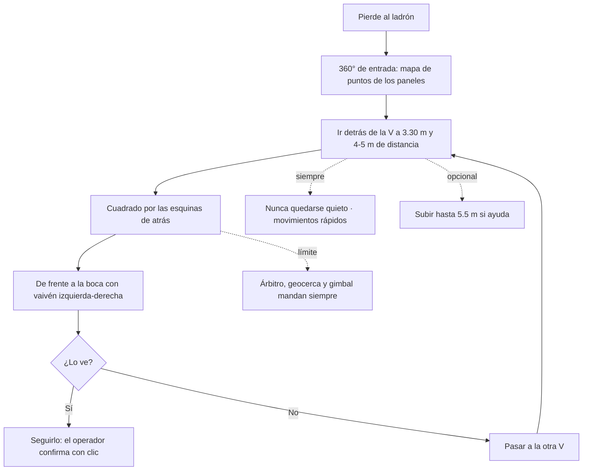

# Ruta de búsqueda de Brahian (D-071)

Son **consejos** de Brahian para enseñarle a la red cómo buscar al ladrón en la cancha de las dos V. No son reglas duras:
la red las aprende de un maestro escrito (B5) y puede apartarse de ellas si le sirve. Siguen mandando el árbitro de
seguridad, la geocerca, el humano en el lazo y los límites del gimbal (−45°..+15°). Los números de distancia son
**valores de partida** que se ajustan midiendo (no están medidos).

## Paso a paso

Se aplica **cada vez que el ladrón se oculta** y la red tiene el mando (D-069/D-070 decide cuánto del tramo tras perderlo).

1. **Entrada.** Un giro de 360° para ver todo y armar el mapa de puntos de los paneles (hoy: giro de entrada a 2.5 m).
2. **Detrás del panel.** Ir al lado de atrás de la V (el que la oculta del dron) a **3.30 m de altura** (la altura segura, D-043)
   y a unos **4-5 m** del panel. Es la misma distancia de seguimiento de 3.5-5 m que ya usa el sistema.
3. **Cuadrado por las esquinas.** Recorrer la parte de atrás como un cuadrado: de esquina a esquina de la V, con la cámara
   mirando hacia donde se vuela. Lado del cuadrado: el ancho de la V (~2.1 m de boca) más un margen de ~2 m por lado.
4. **De frente con vaivén.** Al terminar el cuadrado, mirar de frente a la V moviendo la cámara a la izquierda y a la derecha
   (guiñada de ±30°) para cubrir su boca.
5. **La otra V.** Repetir 2-4 con el otro conjunto (están a 10 m).
6. **Siempre en movimiento.** Movimientos rápidos y **nunca quedarse quieto**: si no hay nada que hacer, seguir el recorrido.
7. **También sin subir.** Debe funcionar con la altura fija en 3.30 m. Subir (hasta 5.5 m) es una ayuda, no un requisito.

## Cómo se enseña (lo hace Simulación V17)

- **Maestro B5:** un programa que sigue esta ruta; mide M1 igual que B0-B4.
- **Imitación** de B5 al empezar, y luego refuerzo con un **bono por avanzar en la ruta** y un **costo por quedarse quieto**.
- **Variante sin subir:** la altura topada en 3.30 m (maestro B5s y red sin los botones SUBIR/BAJAR).

## Qué número decide que "la ruta enseñada" aporta

Todo con 512 partidas, mismas semillas y la cancha real (paneles de 1.5 × 2.2-2.3 m), margen de error de M1 ≈ ±4 puntos.
Referencia hoy (`informes/v17/v173_base_b*.json`, `b4_real_*.json`): B0 11.7 %, B3 24.6 %.

| Pregunta | Número | Se cumple si |
|---|---|---|
| ¿La ruta vale la pena? | M1 de B5 contra B3 | B5 ≥ B3 + 5 puntos |
| ¿La red aprendió la ruta? | M1 de la red contra B5 | red ≥ B5 − 3 puntos |
| **¿La IA aporta?** | M1 de la red contra B3 y B0 | **red ≥ max(B3, B0) + 5 puntos**, o bien, si B5 no supera a B3, red ≥ B3 y la ruta se declara "sin ventaja" |
| ¿Funciona sin subir? | M1 de la red sin SUBIR contra B0 | red sin subir ≥ B0 + 5 puntos |
| ¿Nunca se queda quieta? | % del tiempo con QUEDARSE | < 5 % |
| Seguridad | alcanzado, choques, geocerca, gimbal fuera de rango | 0 como en B0 (si no, no cuenta) |

Si B5 no supera a B3, el resultado honesto para el documento es "la ruta de Brahian no mejora a subir siempre en esta
cancha"; si B5 lo supera pero la red no llega a B5 − 3, es "la ruta sirve, la red todavía no la aprende" y se ajusta la
imitación. En ningún caso se relaja una prueba de reglas duras para que el número salga.
